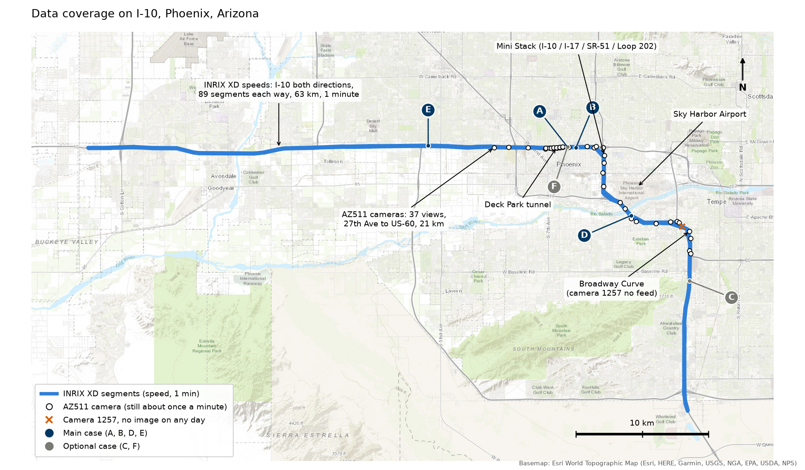
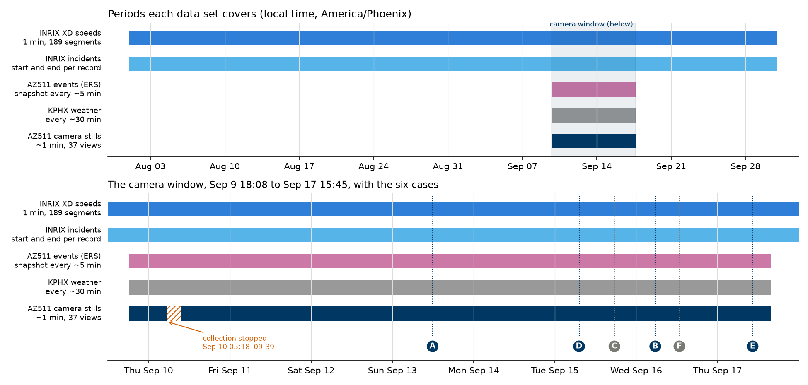

# I-10 incident storyboards

Replays of real incidents on I-10 in Phoenix, built from three kinds of data put on one time axis and
one road axis: INRIX 1-minute speeds, incident records (ERS from AZ511, and INRIX incidents), and AZ511
camera stills taken about once a minute. It is the real-data front end of the camnet camera-evidence
prototype (ADOT SPR-803, Task 4) and the material for the IEEE ITS Magazine lab column.

**Open a storyboard:** see [Storyboards](#5-storyboards) at the end. Each one is a single HTML file
that opens offline.

Contents: [1. Data](#1-data) · [2. Dashboard design](#2-dashboard-design) ·
[3. Choosing the cases](#3-choosing-the-cases) · [4. What the incidents are and what the cases show](#4-what-the-incidents-are-and-what-the-cases-show) ·
[5. Storyboards](#5-storyboards) · [Reproduce](#reproduce) · [Known limits](#known-limits)

---

## 1. Data



*The main map is the camera stretch: 37 AZ511 views over the 21 km from 27th Ave through the Deck Park
tunnel, past the Mini Stack and Sky Harbor Airport, to the Broadway Curve and US-60, each with its ID.
Eight views sit in the tunnel (776–783, four labelled eastbound and four westbound by AZ511). Camera
1257 at Broadway Rd returned AZ511's "no live feed" image on all eight days. The inset is the whole
speed corridor, 63 km of I-10 in each direction from Goodyear to Chandler, with the camera stretch
boxed. Letters mark the six cases; C and E lie outside the camera stretch.*

| Data | Source and how it was collected | Road covered | Period (local time) | Interval | Amount |
|---|---|---|---|---|---|
| **Speeds** | INRIX Roadway Analytics data download, XD segments. Fields: speed, INRIX's historic average speed for that hour and weekday, reference (free-flow) speed, travel time, confidence (C-value) and the share of each minute from real-time data | I-10 eastbound and westbound, 89 XD segments and 63.3 km each way, plus 3 segments on connecting roads (189 in all) | Aug 1 – Sep 30, 2026 | 1 min | 16.6 million segment-minutes; 98.5% real-time data inside the camera window |
| **INRIX incidents** | INRIX Roadway Analytics incident download for the same segments, categories Incident and Construction. One row per record: earliest start, latest end, description, severity, location | Same corridor | Aug 1 – Sep 30, 2026 | One row per record | 1,497 records (1,464 incidents); 179 inside the camera window |
| **AZ511 events (ERS)** | Our collector on ASU's Sol cluster called the AZ511 events API and kept the events inside the corridor box (lat 33.360–33.493, lon −112.156 to −111.937). Each snapshot lists the events active at that moment, so the span of every event and every rewording of its description can be recovered | I-10 through the camera stretch and a few km either side | Sep 9 18:08 – Sep 17 15:43 | About every 5 min | 2,158 snapshots, 86 ERS events (83 crashes and incidents, 2 closures, 1 roadwork) |
| **Camera stills** | The same collector, triggered every minute by Slurm `scrontab`, fetched the current still of each camera view from the AZ511 API. An image identical to the previous one is not saved again; AZ511's "no live feed" image is logged as unavailable. Each UTC day is archived as one tar file in the team Dropbox | 37 camera views on I-10 from 27th Ave to US-60, MP 142.1–155.2, about 21 km | Sep 9 18:08 – Sep 17 15:45 | Median 1.02 min; 1.0–1.4 min most of the time, up to about 3 min when the scheduler queues | 349,756 images, 77 GB in 8 daily tars |
| **Weather** | The same collector, NWS API observations at Phoenix Sky Harbor (KPHX) | Point station by the corridor | Sep 9 18:08 – Sep 17 15:43 | About every 30 min | 40 observations a day |



*Speeds and INRIX incidents cover two months, which gives eight or nine "usual" days of each weekday.
ERS events, weather and camera stills cover the eight days of the camera window. Collection stopped
once, Sep 10 05:18–09:39.*

Things to know about the data:

- **Time.** Everything is shown in local time, America/Phoenix (UTC−7; Arizona keeps no daylight
  saving). The camera tars are named by UTC date, so one tar runs from 17:00 local the day before.
- **Camera timing.** AZ511 can serve a still that is older than the moment we fetched it: the time
  printed on the image ran 0.5–3.6 min behind our fetch time in case A.
- **Camera views move.** Operators turn and zoom the PTZ cameras. A view change is found from the
  difference between consecutive frames, and that is how operator camera moves are dated.
- **Licences.** INRIX data are under ADOT's contract and AZ511 stills are not cleared for publication
  (plates and faces are not blurred). None of the raw data are in this repository; the storyboards
  embed frames and derived speeds, so keep the repository private.

---

## 2. Dashboard design

The question each storyboard answers is the one an ADOT reviewer asked: **what happened on the road,
when, how far it spread, and what the operators did, from the first minute to the recovery.** The page
follows the order of the TSMO playbook: onset, propagation, diversion, action, outcome.

| Part of the page | What it shows | Why it is there |
|---|---|---|
| **One time axis, one road axis** | All sources on minutes of local time and on distance from the incident along the direction of travel | Speeds, records and frames can only be compared once they share both axes |
| **Operator line** | A one-sentence message, e.g. "Queue about 0.8 mi, slow traffic 1.5 mi in all, growing about 5 mph", with 5, 15 and 30 min forecasts and the proposed Tier 1 warning | It uses only data available at that minute, so it shows what a TOC could have known live, not after the fact |
| **Cameras, downstream to upstream** | Each camera's frame at that minute, its role (downstream, site, upstream), its border colour (queue, slow, free), when the queue reached it and left, and a tag when an operator has just moved it | A queue grows upstream; reading the cameras in that order shows it spread and clear. Downstream cameras show the road past the incident was not affected |
| **Time-distance diagram** | Speed against the usual speed for every segment and minute, with the tail of the queue (solid), the tail of slow traffic (dashed), the head (dotted), the forecast range, the incident (✕), secondary crashes (smaller ✕), and the closure periods named in the records | The whole event in one picture, and the place the frames and the speeds can be checked against each other |
| **Travel time against a usual day** | Minutes to drive the plotted road on the incident day, against the median and middle half of the other days of the same weekday in Aug–Sep | It separates what the incident added from the normal peak (case B: +12.7 min at 07:30, on top of an already slow Wednesday peak) |
| **Timeline** | Every ERS and INRIX record and each rewording of an ERS record, the minute the queue reached each camera, operator camera moves, Tier 1, the chapters and the weather | Records change: case B's ERS record said "multiple lanes blocked" at 05:39 and "exit ramp closed" at 06:06 |
| **Frame viewer** | Any frame enlarged, with zoom, pan and frame stepping; the site camera at higher resolution | The scene is usually seen only after an operator zooms in; the detail is in the corners of the frame |
| **Chapters** | Buttons for record, onset, peak, queue gone, recovery and cleared | One click to each stage of the story |

How the queue is found from the speeds:

- Each segment's speed over INRIX's usual speed for that hour and weekday is smoothed with a trailing
  3-minute median (past data only).
- A segment counts as **slow** when that ratio drops below 0.60 and until it rises above 0.75, and as
  **queued** below 0.45 until it rises above 0.55. The two thresholds stop a value hovering at one
  threshold from flipping the queue every minute.
- The queue and the slow traffic are the runs of such segments connected to the incident, up to 1.5 km
  downstream of it. Queues from listed secondary crashes join in, and a run that overlaps the previous
  minute's run is followed after its head has cleared, as happens when a queue's tail keeps moving
  upstream.
- The page and the plotted road grow until the slow traffic has been gone for 10 minutes.

The pages use plain English for an ADOT reader, colour-blind-safe colours (Okabe–Ito: vermillion for
queue, orange for slow, blue for free flow), ADOT blue for headings, and carry the 23 U.S.C. § 407
notice.

**What phase 1 does not do yet.** Two things.

- **The road is a chain of INRIX segments.** No other source uses INRIX's segment IDs: ERS records and
  cameras are placed on it by distance alone, and the ramps are not on it at all, so case B's and case
  D's exit-ramp closures can only be drawn as bars above the diagram.
- **The cameras do not measure anything.** The frames are pictures for a person to look at; every queue
  on the page comes from INRIX speeds. INRIX gives one average speed per segment, and a segment is
  0.3–1.1 km long, so a short blockage can hide inside it. Case B shows this: at 05:55 camera 785 shows
  police holding the lanes and traffic stopped, but the INRIX segment around it is 0.75 km long,
  traffic still moves on the rest of it, and its average speed is not low enough to be marked slow. The
  camera card says "free flow" while the frame shows stopped cars.

**Phase 2 (next)** puts every source on one road network and makes the cameras measure, in this order:

1. **Build the road network from OpenStreetMap.** [osm2gmns](https://github.com/jiawlu/OSM2GMNS) turns
   OpenStreetMap into a GMNS network of the I-10 stretch: directed links with IDs, lane counts and the
   ramps. Each INRIX segment, ERS record and camera is placed on links as a link ID and a position along
   it, with a match score. A match the rules cannot settle (the wrong direction, a ramp or the mainline)
   is flagged, not guessed. The storyboard's road axis then becomes GMNS links, and a ramp closure sits
   on its own ramp link.
2. **Register each camera view to the links.** For the site and nearest cameras of cases A, B and E
   (about 8 views), click 6–8 landmarks in a frame (lane-line ends, gore points, bridge edges) and the
   same points on the map. A geometric fit gives the camera-to-road map: every pixel gets a link and a
   position along it, and every link gets the share of its length the camera sees. Frames with the same
   view reuse it; a view an operator has turned or zoomed needs its own. The minutes spent on each
   camera are recorded, because that is what an agency would pay to repeat it.
3. **Ask a vision-language model (VLM) multiple-choice questions.** The registered links are drawn on
   the frame as numbered lines, with arrows for direction. The VLM answers only with a link number, yes,
   no or "can't tell", never with a position:
   - Is link 3, eastbound, queued in this frame?
   - Which numbered link is the stopped traffic on?
   - After an operator has moved the camera, which of these candidate overlays lies on the road?

   Distances come from the geometric fit, not from the VLM, because current VLMs are poor at depth,
   direction and counting. Each question covers one link and one direction. The answers are scored
   against hand labels on the six cases before any is shown, and the page marks each camera reading as
   checked by a person or answered by the VLM.

With the cameras on the links, the rest follows:

4. **Count vehicles** with an off-the-shelf detector and turn the count into vehicles per km on each
   link a camera sees; with the INRIX speed this gives the flow. Case B's camera 785 would then read
   "queued" from its own frame.
5. **Place the queue tail between cameras.** Where no camera sees the road, traffic-wave theory bounds
   how far the tail can have moved since the last camera saw it.
6. **Replace the straight-line forecast** with one built on those measurements.

---

## 3. Choosing the cases

All incident records in the camera window were screened, then the strongest were read by eye.

| Step | Rule | Left |
|---|---|---|
| Records | ERS events and INRIX incidents active inside the camera window | 179 records |
| Episodes | Records of one event merged: same direction, within 1.5 km, overlapping in time | **159 episodes** (72 with an ERS record, 87 INRIX only) |
| Traffic effect | At least 10 min of queue connected to the incident (speed under 70% of usual) | 47 |
| Cameras | A working camera at the site or up to 5 km upstream (at least half its frames present) | 21 |
| Cause | No queue in the 30 min before the record, which leaves out recurring congestion | 10 |
| Story | A site camera within 0.5 km, at least two upstream cameras the queue passes, at least one downstream camera that stays free | 1 met all four; several missed one |
| Operator signal | A camera within 1 km moved by an operator between 20 min before and 40 min after the record; every scene we found was seen this way | 58 episodes had one |
| By eye | Time-distance plots and frames of the top-ranked episodes, every camera | **4 main and 2 optional cases** |

The full ranking is written by `scripts/10_final_sweep.py`; [DEMO_CASES.md](DEMO_CASES.md) has the notes
on each case. The screen used a single 0.70 threshold; the storyboards then use the smoothed two-level
rule described above.

---

## 4. What the incidents are and what the cases show

**The 159 episodes by type**

| Type | Episodes | With ≥10 min of queue | Working camera within 300 m |
|---|---|---|---|
| Crash | 86 | 32 | 25 |
| Disabled or stalled vehicle | 45 | 8 | 12 |
| Other: infrastructure damage, signals, medical, repairs | 15 | 4 | 7 |
| Debris or animal | 9 | 2 | 5 |
| Pedestrian on the road | 2 | 0 | 1 |
| Vehicle fire | 2 | 1 | 0 |

Most records, 112 of 159, leave no queue of 10 minutes: shoulder crashes and disabled vehicles that
traffic passes. The episodes with a queue fall into a few kinds by what the cameras can show:

| Kind | What the cameras show | Cases |
|---|---|---|
| **Full chain** | The scene, the queue reaching upstream camera after camera and clearing, and free flow downstream | A, B |
| **Scene through an operator's zoom** | Police, tow trucks and fire engines, seen once an operator turns and zooms a PTZ camera; the mainline effect may be small | D (also A and B) |
| **Queue tail and secondary crashes** | The incident is beyond the cameras; they see its queue's tail, where secondary crashes happen | E |
| **Queue without the scene** | The incident is past the last camera; only the upstream queue is seen | C |
| **Confounded** | Congestion before the incident, from the peak or weather, so its share cannot be separated | F |

What the cases show, and what the article and the ADOT session can take from them:

1. **No camera catches the moment of a crash.** Stills come about once a minute and most views are wide
   or pointed elsewhere. What they catch is the scene a few minutes later, after an operator turns a
   camera to it, and the queue as it spreads and clears.
2. **The traffic and the operators often move before the record.** The queue reached the Tier 1 length
   2 min before the ERS record in case A and 3 min before it in case B. An operator moved the site camera
   2 min before the record in case B (camera 785) and in case E (camera 769, secondary crash).
3. **Records change while the event runs.** Case B went from "multiple lanes blocked" to "exit ramp
   closed"; case D from "intersection blocked" to "exit ramp closed", in a record open 12.7 hours. The closure bars
   follow each wording.
4. **Cameras see what segment speeds average away.** Inside a 0.3–1.1 km XD segment, a lane closure and
   the exact tail position are visible only on camera (case B, camera 785).
5. **An incident's cost is the difference from a usual day.** Case B added up to 29 min to a 16 km trip
   at 06:00 and still 7–13 min during the 07:30–08:00 peak; case D's ramp closure added under 3 min to
   the mainline.
6. **Queues outlive their incidents and move.** Case E's second queue came loose from its crash and kept
   moving upstream past three cameras before it dissolved.

---

## 5. Storyboards

Each storyboard is **one self-contained HTML file**: every camera frame is inside it, one a minute, so it
opens offline on any computer with a browser.

**To open one:**

1. Click its link below. GitHub opens a page that says "Sorry about that, but we can't show files that
   are this big right now". That is expected: GitHub does not show HTML files as web pages, and
   **View raw** only shows the file's source text.
2. Click the **download icon** (the arrow pointing down, to the right of **Raw** and the copy icon, at
   the top right of the file view). The file is saved to your computer.
3. Double-click the downloaded file. It opens in your browser and needs no internet connection.

### Main cases

| | Storyboard | What it shows | Size |
|---|---|---|---|
| A | [Sun Sep 13, EB 7th St, car into a light pole](out/standalone/A_0913_7thst_storyboard.html) | The full chain in daylight: scene camera, queue through the tunnel and back, downstream unaffected | 13 MB |
| B | [Wed Sep 16, EB tunnel, crash blocking several lanes, then an exit-ramp closure](out/standalone/B_0916_tunnel_storyboard.html) | Slow traffic over 12 km across 10 cameras; scene camera moved 2 min before the record; the morning peak on top after 07:00 | 37 MB |
| D | [Tue Sep 15, WB University Dr, crash and ramp closure](out/standalone/D_0915_university_closure_storyboard.html) | The scene through operator PTZ zoom (8.9x, 13.3x); a ramp closure in a record open 12.7 h, with a small mainline effect | 25 MB |
| E | [Thu Sep 17, WB Exit 138, crash and two secondary crashes](out/standalone/E_0917_exit138_secondary_storyboard.html) | Largest delay of the 8 days; a second queue from a secondary crash runs past 769, 770 and 771 | 11 MB |

### Optional cases

| | Storyboard | Why it is kept | Limits | Size |
|---|---|---|---|---|
| C | [Tue Sep 15, EB Broadway Curve, vehicle fire](out/standalone/C_0915_broadway_fire_storyboard.html) | The Broadway Curve pilot corridor; logged by INRIX, not by ERS; a dead camera (1257) for phase 2 to bridge | No site or downstream camera: the fire is 2 km past the last camera | 5 MB |
| F | [Wed Sep 16, EB 3rd St, crash in a thunderstorm queue](out/standalone/F_0916_thunderstorm_storyboard.html) | Rain on camera 784, KPHX thunderstorms | Congestion began before the crash | 43 MB |

The site camera is stored at 800 x 450 for the enlarged viewer; the other cameras at 480 x 270.

---

## Reproduce

The raw data are not in this repository: the AZ511 daily tars, the INRIX exports and everything built
from them under `data/` stay where they were downloaded and are ignored by git.

1. Copy `config/paths.example.json` to `config/paths.json` and set the four paths: the AZ511 daily
   tar archive, the camera list, the INRIX 1-minute XD export and the INRIX incident export.
2. Extract the manifests, events and weather from the tars into `data/az511/` (small; the images stay
   in the tars):
   `for d in <archive>/*/; do tar -xf $d/*.tar -C data/az511 events weather 'camera_manifest_*'; done`

```bash
pip install -r requirements.txt
python scripts/tarindex.py              # byte offsets of every frame in the tars, once (about 1 min)
python scripts/01_slice_speed.py <inrix_1min_dir> data/speed_0909_0917.parquet
python scripts/02_ers_events.py data/az511 data/ers_events.csv
python scripts/03_screen_incidents.py   # episodes, speed impact, nearby cameras
python scripts/08_story_screen.py       # camera roles and queue arrival per episode
python scripts/10_final_sweep.py        # adds operator camera moves; ranks episodes
python scripts/11_build_storyboard.py   # out/storyboard/<case>/index.html for every case
python scripts/12_standalone_page.py    # out/standalone/<case>_storyboard.html, one file per case
python scripts/14_readme_figures.py     # the maps and the timeline in docs/figures/
python -m http.server 8512 --directory out/storyboard   # optional: browse the unpacked pages
```

Phase 2 step 1 puts every source on a GMNS road network built from OpenStreetMap. osm2gmns 1.0 ships
wheels for Python 3.8–3.12 only, so script 15 runs in its own environment; 16 and 17 need only the
packages above.

```bash
python3.12 -m venv ~/.venvs/gmns && ~/.venvs/gmns/bin/pip install osm2gmns==1.0.1 pandas shapely
~/.venvs/gmns/bin/python scripts/15_osm_network.py # downloads OSM once; data/network/node.csv, link.csv
python scripts/16_place_sources.py          # I-10 path; XD segments, ERS events and cameras on links
python scripts/17_gazetteer.py              # mileposts, exits, cross streets; ERS milepost check
python scripts/18_network_map.py           # topology checks; out/network/network_map.html (+ .gpkg with geopandas)
```

`scripts/frame_viewer.py` is a local viewer for any camera at any minute, reading frames straight from
the tars (`python scripts/frame_viewer.py`, then http://localhost:8511).

| Script | Does |
|---|---|
| `corridor.py` | Orders the I-10 XD segments along each direction; distance axis in km |
| `tarindex.py` | Indexes the tars; reads one frame by seek |
| `01`–`03` | Speed slice, ERS events from AZ511 snapshots, incident screen |
| `04`, `06`, `07`, `09` | Time-distance plots and contact sheets for review |
| `05` | Extracts frames of selected cameras and windows |
| `08`, `10` | Story screen (site, upstream, downstream cameras) and final ranking |
| `11` | Builds the storyboards |
| `12` | Packs each storyboard into one self-contained HTML file |
| `14` | Draws the README figures (basemap: Esri World Topographic Map) |
| `15` | GMNS network of the study area from OpenStreetMap (ODbL) with osm2gmns |
| `gmns.py` | Loads the network; walks the I-10 mainline path in each direction |
| `16` | Places INRIX XD segments, ERS events and cameras on links, flagging what the rules cannot settle |
| `17` | Gazetteer of mileposts, exits and cross streets; checks ERS milepost text against the event position |
| `18` | Topology checks and an interactive layer map of the network and everything placed on it (private: holds INRIX geometry) |
| `typical_days.py` | Same-weekday INRIX speeds for the usual-day travel time |

## Known limits

- The usual speed is INRIX's historic average for the hour and weekday, not the Track 1 counterfactual.
- Queue head and tail are at XD segment resolution (0.3–1.1 km) and carry INRIX latency of a few minutes;
  the smoothing adds about one more.
- AZ511 stills can be minutes older than the time we fetched them. Frame times should come from the
  overlay (OCR) before camera timing is used for measurement.
- The straight-line forecast overshoots when a queue's growth slows; 30 min forecasts held the observed
  length in only 25–46% of minutes.
- Camera 1257 (Broadway Rd) returned no image on any of the 8 days. Collection stopped 05:18–09:39 on
  Sep 10.
- Camera moves are found from frame-to-frame change; dawn light changes can trigger it.
- Any still or clip leaving the team needs ADOT's written permission and blurred plates and faces.
